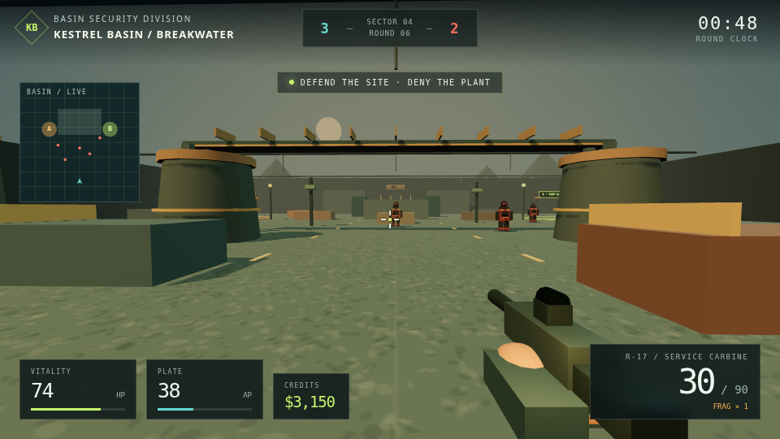

# Kestrel Basin: Breakwater Protocol

[](https://make.fun/bounty/threejs-fps-02?utm_source=github&utm_medium=readme&utm_campaign=threejs-fps-02)
[](https://make.fun/bounty/threejs-fps-02/leaderboard?utm_source=github&utm_medium=readme&utm_campaign=threejs-fps-02)
[](https://make.fun/bounty/threejs-fps-02?utm_source=github&utm_medium=readme&utm_campaign=threejs-fps-02)

**Breakwater Protocol** is an original, single-player three.js tactical FPS set inside a storm-battered coastal flood-control facility. Defend two control sites, fight mobile raiders, and prevent a timed breach charge from taking the basin.



Built for the [make.fun three.js tactical FPS bounty](https://make.fun/bounty/threejs-fps-02).

## Play locally

Requires Node.js 22.18 or later. The game is static ES modules with a bundled copy of Three.js 0.187.0; there is no build step or external asset request.

```sh
node serve.ts
```

Open [http://localhost:8080](http://localhost:8080).

## Controls

- **W / A / S / D:** move; **mouse:** look; **left mouse:** fire; **right mouse:** aim
- **Shift:** sprint; **Ctrl:** crouch; **Space:** jump
- **R:** reload; **G:** throw a frag; **Q:** switch between the carbine and sidearm
- **B:** toggle the buy menu between rounds; **1–6:** select a buy item; **Enter:** deploy; **Esc:** close the armory
- Hold **E** or **F** near the armed device to defuse it

## Screenshots

The `screenshots/` directory contains direct Chromium captures of the arena, armory, salt-yard lane, and armed-device state.

## License

The original game and project files are released under the MIT License. Three.js retains its own included license in `game/vendor/three/`.
